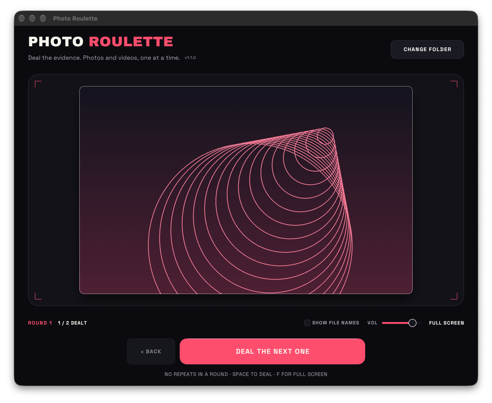

# Photo Roulette

<p align="center">
  
</p>

[](https://github.com/Panolix/Photo-Roulette/releases)
[](https://creativecommons.org/licenses/by-nc-sa/4.0/)
[](https://github.com/emilk/egui)
[](https://github.com/Panolix/Photo-Roulette/actions/workflows/ci.yml)

A tiny desktop app for the group chat's worst photos — and videos.

Point it at a folder of high-school evidence, hit **Deal the first one**, and it
shows one random photo or video at a time. Every item gets dealt exactly once
per round, so nobody has to see the same cursed memory twice.

Everything stays local. No account, cloud service, upload, or tracking.

<p align="center">
  
</p>

## Features

- Imports a folder of photos and videos, including subfolders.
- Deals one random item at a time with a short shuffling animation.
- Uses a shuffle bag: no repeats until every item in the round has been shown.
- Starts a new round with a fresh shuffle when the deck runs out.
- Avoids opening a new round with the item that just closed the previous one.
- Folder scanning happens in the background, with a live file count and a cancel button.
- Photos and video frames are decoded in the background, so the UI stays responsive.
- Click a video to pause/resume; drag the timeline to seek; restart without advancing the round.
- Volume slider, `M` to mute, and remembered volume.
- `‹ BACK` / `Backspace` returns to the previous item without messing up the round.
- Remembers the last folder, volume, filename overlay, and window geometry.
- Fullscreen mode for group viewing.
- Optional filename overlay.
- Drag a folder (or a pile of files) straight onto the window.
- Handles EXIF rotation, large images, transparency, HEIC/AVIF, and many video formats.
- No repeats are based on file paths; make sure your folder doesn't contain duplicate copies.

## Download

Grab a build from the [latest release](https://github.com/Panolix/Photo-Roulette/releases/latest).

| OS | Artifact | Notes |
| --- | --- | --- |
| macOS (Apple Silicon + Intel) | `Photo-Roulette-*-macOS-universal.dmg` | Includes FFmpeg. Drag **Photo Roulette** into Applications. Ad-hoc signed, not notarized. |
| Windows x64 | `Photo-Roulette-Setup-*.exe` | Includes FFmpeg. Inno Setup installer. |
| Linux x86_64 | `photo-roulette_*_amd64.deb` or `photo-roulette-*-linux-x86_64.tar.gz` | Includes FFmpeg. `sudo apt install ./photo-roulette_*_amd64.deb` |

Installers are larger than the app itself because they bundle an LGPL FFmpeg
build for offline video playback. The macOS app is ad-hoc signed because it is
built without an Apple Developer ID. On another Mac, Gatekeeper may require
right-click → **Open** the first time.

## Video support

Release packages include [ffmpeg](https://ffmpeg.org/), so videos work without a
separate install. The app looks for FFmpeg next to the executable, in its
`ffmpeg/` subfolder, in common install locations, and in `PATH`. It also has a
**Locate ffmpeg** dialog that remembers a custom path.

Source builds do not include FFmpeg; install it or build the bundle:

```sh
# macOS
brew install ffmpeg

# Windows (PowerShell)
winget install Gyan.FFmpeg

# Ubuntu / Debian
sudo apt install ffmpeg
```

The app supports the formats FFmpeg can decode, including **MP4, MOV, M4V, WMV,
AVI, MKV, and WebM**. Videos are decoded to a maximum of 1920 px at 30 fps.
Audio is extracted as compact AAC/M4A before playback, with a WAV fallback.
Video playback, including sound, works on macOS, Windows, and Linux.

### Bundling FFmpeg

Release builds use `packaging/ffmpeg/`:

- macOS: `build-macos.sh` builds a universal LGPL FFmpeg from source.
- Windows/Linux: `fetch-windows.ps1` / `fetch-linux.sh` download pinned BtbN LGPL
  builds and verify their SHA-256 checksums.

The bundled builds are unmodified LGPL redistributions; license and source
information are included in each package. See
[`packaging/ffmpeg/README.md`](packaging/ffmpeg/README.md). Do not bundle a GPL
build into a non-commercial package without meeting the GPL's requirements.

## Controls

| Action | How |
| --- | --- |
| Import / change folder | Button in the top right, or drop a folder on the window |
| Deal the next item | Big button, or press `Space` |
| Go back one item | `‹ BACK`, or press `Backspace` |
| Pause / play video | Click the video, or press `P` |
| Seek video | Drag the timeline, or use `←` / `→` |
| Restart video | Circular arrow on the video, or press `R` |
| Mute / unmute | `M`, or the volume slider |
| Fullscreen | `F`, or the fullscreen button |
| Open the folder picker | `Cmd+O` / `Ctrl+O` |

## Build from source

You need a recent stable Rust toolchain: <https://rustup.rs>

```sh
git clone https://github.com/Panolix/Photo-Roulette.git
cd Photo-Roulette
cargo run --release
```

Or start with a folder already loaded:

```sh
cargo run --release -- ~/Pictures/high-school
```

Platform build requirements:

- **macOS:** Xcode Command Line Tools.
- **Windows:** Microsoft C++ Build Tools.
- **Linux:** the usual OpenGL/X11/Wayland development packages used by
  `eframe`/`winit`, plus `pkg-config` and `libasound2-dev` for audio.

The release build is recommended; debug builds decode photos and video at debug
speed.

## Installers and packaging

```sh
# macOS .app
./make-app.sh

# macOS .dmg
./packaging/macos/make-dmg.sh

# Windows installer (run on Windows with Inno Setup installed)
iscc packaging/windows/PhotoRoulette.iss /DMyAppVersion=1.1.0

# Linux .deb and portable tarball (run on Linux)
VERSION=1.1.0 ./packaging/linux/build-packages.sh
```

GitHub Actions builds the macOS DMG, Windows installer, Linux `.deb`, and Linux
tarball for each tagged release, and publishes a `SHA256SUMS` file. Tag a
release with:

```sh
git tag v1.1.0
git push origin v1.1.0
```

The workflows live in `.github/workflows/ci.yml` and `.github/workflows/release.yml`.

## Media formats

Photos: JPG, PNG, GIF, WebP, BMP, TIFF, QOI, TGA, HDR, EXR, and more. On macOS,
HEIC/HEIF and AVIF are supported through ImageIO (`sips`); on Windows and Linux
they go through ffmpeg when it is installed. HEIC support depends on the ffmpeg
build including an HEIF decoder.

Videos: MP4, MOV, M4V, WMV, AVI, MKV, WebM, FLV, MPEG, 3GP, and other formats
ffmpeg can decode.

Unreadable files are skipped automatically. Folders are scanned recursively;
hidden folders and macOS photo libraries/app bundles are ignored. Scanning can
be cancelled and never blocks the window.

## Settings

Settings are stored as JSON in the platform config directory:

- macOS: `~/Library/Application Support/com.panolix.photoroulette/settings.json`
- Windows: `%APPDATA%\PhotoRoulette\settings.json`
- Linux: `~/.config/photo-roulette/settings.json` (or `$XDG_CONFIG_HOME`)

They contain the last folder path, volume, filename-overlay preference, and an
optional custom ffmpeg path. Delete the file to reset the app.

## How the "no repeats" part works

When a folder is imported, the app builds a shuffled queue (a shuffle bag). Each
deal pops one item off the queue. Once the queue is empty, the round is complete;
pressing the button again builds a new shuffled queue from all media. Within a
round there can be no duplicate file paths, and a single-item library is the
only unavoidable repeat.

Visually identical copies saved as different files are still separate items.
Remove duplicates before the party if you don't want them to appear twice.

## Development

```sh
cargo fmt --all -- --check
cargo clippy --locked --all-targets -- -D warnings
cargo test --locked
cargo deny check
cargo audit
```

The test suite covers the shuffle bag, folder scanning and cancellation,
settings/history, and a generated-video pipeline test (skipped automatically if
ffmpeg is not installed). CI also launches the real GUI with `--smoke-test`,
loads an image, renders it, and exits cleanly on macOS and Linux (Windows CI
runners only expose OpenGL 1.1, so Windows GUI validation needs a real desktop).
Package-content and CLI checks run alongside those tests.

## Known limitations

- macOS app builds are ad-hoc signed and not notarized.
- Windows installers are unsigned, so SmartScreen may warn on first launch.
- Video controls support play/pause, seek, restart, and volume, but not speed or
  subtitles.
- HEIC on Windows/Linux depends on the bundled FFmpeg build including an HEIF
  decoder. macOS always supports it through ImageIO.
- No RAW/PSD support.
- The app does not modify or delete anything in the imported folder.
- Installers are roughly 50–100 MB because they include FFmpeg.

## Credits

- **Archivo Black** — Omnibus-Type, SIL Open Font License
- **Space Grotesk** — Florian Karsten, SIL Open Font License
- **Bootstrap Icons** — The Bootstrap Authors, MIT License (restart glyph)
- Video decoding via [ffmpeg](https://ffmpeg.org/), bundled in release packages
  as an LGPL build. macOS builds from source; Windows/Linux use pinned
  [BtbN FFmpeg-Builds](https://github.com/BtbN/FFmpeg-Builds) artifacts.
- Built with [egui](https://github.com/emilk/egui) / eframe.

License files for the fonts and icon are in `assets/fonts/` and `assets/icons/`.

## License

This project is licensed under [CC BY-NC-SA 4.0](https://creativecommons.org/licenses/by-nc-sa/4.0/).

**License text:** [human-readable summary](https://creativecommons.org/licenses/by-nc-sa/4.0/) · [full legal code](https://creativecommons.org/licenses/by-nc-sa/4.0/legalcode.en) · [SPDX entry](https://spdx.org/licenses/CC-BY-NC-SA-4.0.html) · [LICENSE](LICENSE)

**Source-available, not open source.** You may download, use, fork, modify and
share it for non-commercial purposes, provided you credit **Panagiotis
Smponias**, link back to this repository, state what you changed, and license
your version under the same terms.

**Commercial use requires a paid license** — see [COMMERCIAL.md](COMMERCIAL.md).
Attribution, share-alike and trademark terms: [NOTICE](NOTICE).

## Author

**Panagiotis Smponias**

- Email: info@cityframe-photography.com
- GitHub: [@Panolix](https://github.com/Panolix)
- Website: [City Frame Photography](https://cityframe-photography.com)

## Acknowledgments

- The group chat, for the evidence.
- [ffmpeg](https://ffmpeg.org/) for decoding video.
- [egui](https://github.com/emilk/egui) and the Rust ecosystem.
